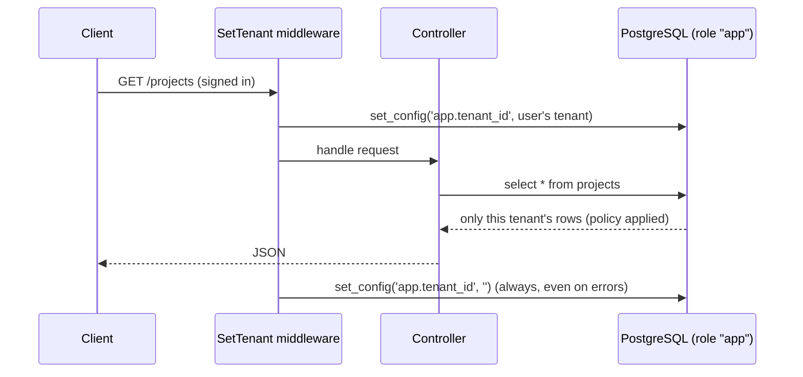

# SaaS Starter (RLS)

[](https://github.com/arkhan0072-dev/saas-starter-rls/actions/workflows/ci.yml)

A multi-tenant Laravel starter where **PostgreSQL itself keeps tenants apart**. Every tenant table has a row-level security (RLS) policy, so a query that forgets `where tenant_id = ?`, a raw SQL report or a bug in a package still cannot read or change another tenant's data.

> Work in progress. Implemented so far: tenant isolation with RLS, a restricted database role, sign-up and token login, roles and email invitations, an append-only audit log, tenant-aware queued jobs, and a tenant-scoped API for one example resource (projects).

## Why RLS

Most Laravel multi-tenancy relies on a global Eloquent scope. That protects Eloquent queries only: `DB::table()`, raw SQL, `->withoutGlobalScopes()` and every query in a third-party package go straight past it, and one missed scope is a data leak between customers.

Here the rule lives in the database:

```sql
alter table projects enable row level security;
alter table projects force row level security;   -- applies to the table owner too
create policy tenant_isolation on projects
    using      (tenant_id = nullif(current_setting('app.tenant_id', true), '')::bigint)
    with check (tenant_id = nullif(current_setting('app.tenant_id', true), '')::bigint);
```

- `using` hides other tenants' rows from `select`, `update` and `delete`.
- `with check` rejects inserting a row for another tenant, or moving a row to one.
- With no tenant set, the comparison is `NULL`, so nothing is visible and nothing can be written: **it fails closed**.

## How it works



- **Two database roles.** Migrations run as `owner`. The app connects as `app`, which is not a superuser, has no `BYPASSRLS` and does not own the tables, so PostgreSQL enforces the policies on every query it makes. A test checks this on every run.
- **`Tenancy`** stores the current tenant on the connection and offers `run($tenant, fn () => ...)`, which restores the previous tenant afterwards, even when the callback throws.
- **`SetTenant` middleware** scopes each request to the signed-in user's tenant and refuses requests that reach it without a user.
- **`BelongsToTenant`** fills in `tenant_id` on new models. `tenant_id` is not mass-assignable, so a client cannot choose it.
- **`RowLevelSecurity::enable('table')`** adds the policy in a migration; every new tenant table is one line.

The controller has no tenant filtering at all:

```php
public function index(): JsonResource
{
    return JsonResource::collection(Project::orderBy('id')->get());
}
```

## What the tests prove

All tests run against real PostgreSQL as the restricted `app` role. The isolation tests use raw SQL on purpose, because that is what an Eloquent scope would not catch.

| Scenario | Result |
|---|---|
| Tenant A runs `select count(*) from projects` | sees only its own rows |
| No tenant set | sees nothing, cannot insert |
| Tenant A inserts a row with Tenant B's id | rejected by PostgreSQL |
| Tenant A runs `update projects set ...` / `delete from projects` without a where clause | only A's rows change |
| Tenant A moves a row to Tenant B | rejected by PostgreSQL |
| Client sends `tenant_id` of another tenant in the API | ignored |
| Tenant middleware used without `auth` | 401, nothing runs |
| New sign-up while other tenants have data | starts with an empty workspace |
| User creation fails during sign-up | no tenant is left behind |
| Sixth login attempt in a minute | 429 Too Many Requests |
| Admin deletes another tenant's project by id | 404, the row is invisible |
| Member tries to invite or delete | 403 |
| Invitation for the `owner` role | rejected |
| Invitation accepted twice, expired, or with a made-up code | rejected |
| Invitations queried with no tenant, or from another tenant | none visible |
| Application runs `update` or `delete` on `audit_logs` | permission denied by PostgreSQL |
| Invitation is logged | token hash is not in the entry |
| Member opens the audit log | 403 |
| Job dispatched by tenant A, run by a worker with no tenant | sees only A's rows |
| Tenant job dispatched with no tenant | fails instead of running |
| After a job finishes | worker's tenant is cleared |
| After a request or a failed `run()` | tenant is cleared |

CI runs Pint, PHPStan at max level, and the tests on PHP 8.3 and 8.4 with a 100% line coverage minimum.

## API

| Method | Path | Auth | Description |
|---|---|---|---|
| `POST` | `/api/register` | | Sign up a company: creates its tenant and first user together, returns an API token |
| `POST` | `/api/login` | | Returns an API token. Limited to 5 attempts a minute per email and IP address |
| `POST` | `/api/logout` | token | Revokes the token used for the request |
| `GET` | `/api/projects` | token | The tenant's projects |
| `POST` | `/api/projects` | token | Create a project in the tenant |
| `DELETE` | `/api/projects/{id}` | token, owner or admin | Delete a project; another tenant's id answers 404 |
| `POST` | `/api/invitations` | token, owner or admin | Invite someone by email as `admin` or `member`. Re-inviting replaces the pending invitation |
| `POST` | `/api/projects/export` | token, owner or admin | Queue a CSV export of the tenant's projects; answers 202 |
| `GET` | `/api/audit-log` | token, owner or admin | The tenant's audit log, newest first, 50 per page |
| `POST` | `/api/invitations/accept` | | Create an account from an invitation code; it joins the inviting tenant with the invited role |

```bash
curl -X POST http://localhost:8000/api/register   -H "Accept: application/json" -H "Content-Type: application/json"   -d '{"company":"Initech","name":"Peter","email":"peter@initech.test","password":"correct-horse-battery","password_confirmation":"correct-horse-battery"}'

curl http://localhost:8000/api/projects -H "Accept: application/json" -H "Authorization: Bearer <token>"
```

Sign-in failures return the same message whether the email exists or not, and take the same time, so the API does not reveal which emails are registered.

## Roles and invitations

Each user has one role in their tenant: **owner** (whoever signed up), **admin** or **member**. Owners and admins can invite people and delete shared data; members cannot.

Invitations are tenant data, so they are protected by RLS like everything else. That raises a problem: the person accepting an invitation is not signed in yet, so no tenant is set and the invitation is invisible. Instead of turning RLS off, one narrow `security definer` function answers a single question with the owner's rights:

```sql
create function invitation_tenant(p_token_hash text) returns bigint
language sql stable security definer set search_path = public
as $$ select tenant_id from invitations where token_hash = p_token_hash and accepted_at is null $$;
```

The app then switches into that tenant and does the rest under RLS as usual: loads the invitation with a row lock (two simultaneous accepts cannot both succeed), checks the expiry, creates the user and marks the invitation used. The emailed code is never stored, only its SHA-256 hash.

## Audit log

Models that use the `Audited` trait (projects and invitations) write an entry for every create, update and delete: who did it, what happened, and what changed.

```json
{ "action": "project.updated", "user_id": 7, "subject_id": 12,
  "changes": { "name": { "old": "Draft", "new": "Final" } } }
```

- **Hidden fields never enter the log.** The invitation token hash is `$hidden` on the model, so it is left out, as passwords would be.
- **Append-only in the database.** The migration revokes `UPDATE`, `DELETE` and `TRUNCATE` on `audit_logs` from the `app` role, so not even a bug in the application can rewrite history.
- **Private per tenant**, through the same RLS policy as other tenant data.

## Queued jobs

A queue worker has no request and no signed-in user, so on its own it would run every job with no tenant and RLS would hide all rows. Instead:

1. Every queue payload records the tenant that was current at dispatch (`Queue::createPayloadUsing` in `AppServiceProvider`).
2. Jobs that use the `TenantAware` trait get the `RestoreTenant` middleware, which switches into that tenant for the job and back out afterwards.
3. Inside the job, `$this->tenantId()` throws if there is no tenant, so a job dispatched from the wrong place fails loudly instead of quietly exporting nothing.

```php
class ExportProjects implements ShouldQueue
{
    use Queueable, TenantAware;

    public function handle(): void
    {
        $tenantId = $this->tenantId();               // fails if dispatched outside a tenant
        $projects = Project::orderBy('id')->get();   // RLS: only this tenant's rows
        // ...
    }
}
```

The tests push jobs through the real database queue and a `queue:work` worker, so they prove the tenant really travels with the job.

One pitfall the tests caught: `Job::dispatch()` queues the job when its `PendingDispatch` is destroyed. Inside `Tenancy::run($tenant, fn () => Job::dispatch())` that happens after `run()` has already cleared the tenant, so use a statement body: `function () { Job::dispatch(); }`.

## Quick start

Requirements: PHP 8.3+, Composer, Docker.

```bash
composer install
cp .env.example .env && php artisan key:generate
docker compose up -d                       # PostgreSQL with the "app" role and a test database
php artisan migrate --database=owner       # migrations run as the table owner
vendor/bin/pest                            # tests
```

## Design decisions

- **The tenant lives on the database connection** (`set_config(..., false)`), not in a global PHP variable that queries would have to remember to read.
- **`users`, `tenants` and `personal_access_tokens` have no RLS.** Sign-in and token lookup must find a user before any tenant is known. Tables holding customer data get RLS.
- **Sign-up is one transaction.** If creating the user fails, the new tenant is rolled back too, so there are no tenants without an owner.
- **Tenant before route model binding.** `SetTenant` is placed ahead of `SubstituteBindings` in the middleware priority, otherwise binding would look up `{project}` before the tenant is set and RLS would hide it.
- **Default privileges instead of per-table grants.** The first migration grants the `app` role access to every table the owner creates later, so a new table cannot be forgotten.

## Not included yet

- **Scheduled commands** must call `Tenancy::run()` for each tenant themselves.
- **Connection poolers in transaction mode** (e.g. PgBouncer) can hand the connection to another request between statements; this needs `set_config(..., true)` inside a transaction per request.
- Rate limiting and email verification for sign-up.
- Changing a member's role, removing members and transferring ownership.
- Writing the audit entry in the same transaction as the change it records (today it follows the change).
- Subscription billing and an admin panel.

## License

MIT
