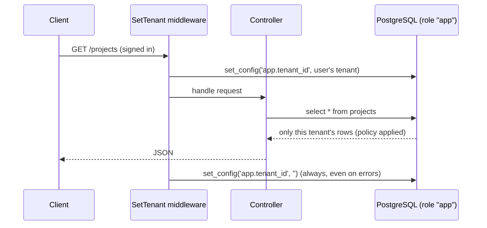

# SaaS Starter (RLS)

[](https://github.com/arkhan0072-dev/saas-starter-rls/actions/workflows/ci.yml)

A multi-tenant Laravel starter where **PostgreSQL itself keeps tenants apart**. Every tenant table has a row-level security (RLS) policy, so a query that forgets `where tenant_id = ?`, a raw SQL report or a bug in a package still cannot read or change another tenant's data.

> Work in progress. Implemented so far: tenant isolation with RLS, a restricted database role, tenant-scoped API for one example resource (projects).

## Why RLS

Most Laravel multi-tenancy relies on a global Eloquent scope. That protects Eloquent queries only: `DB::table()`, raw SQL, `->withoutGlobalScopes()` and every query in a third-party package go straight past it, and one missed scope is a data leak between customers.

Here the rule lives in the database:

```sql
alter table projects enable row level security;
alter table projects force row level security;   -- applies to the table owner too
create policy tenant_isolation on projects
    using      (tenant_id = nullif(current_setting('app.tenant_id', true), '')::bigint)
    with check (tenant_id = nullif(current_setting('app.tenant_id', true), '')::bigint);
```

- `using` hides other tenants' rows from `select`, `update` and `delete`.
- `with check` rejects inserting a row for another tenant, or moving a row to one.
- With no tenant set, the comparison is `NULL`, so nothing is visible and nothing can be written: **it fails closed**.

## How it works



- **Two database roles.** Migrations run as `owner`. The app connects as `app`, which is not a superuser, has no `BYPASSRLS` and does not own the tables, so PostgreSQL enforces the policies on every query it makes. A test checks this on every run.
- **`Tenancy`** stores the current tenant on the connection and offers `run($tenant, fn () => ...)`, which restores the previous tenant afterwards, even when the callback throws.
- **`SetTenant` middleware** scopes each request to the signed-in user's tenant and refuses requests that reach it without a user.
- **`BelongsToTenant`** fills in `tenant_id` on new models. `tenant_id` is not mass-assignable, so a client cannot choose it.
- **`RowLevelSecurity::enable('table')`** adds the policy in a migration; every new tenant table is one line.

The controller has no tenant filtering at all:

```php
public function index(): JsonResource
{
    return JsonResource::collection(Project::orderBy('id')->get());
}
```

## What the tests prove

All tests run against real PostgreSQL as the restricted `app` role. The isolation tests use raw SQL on purpose, because that is what an Eloquent scope would not catch.

| Scenario | Result |
|---|---|
| Tenant A runs `select count(*) from projects` | sees only its own rows |
| No tenant set | sees nothing, cannot insert |
| Tenant A inserts a row with Tenant B's id | rejected by PostgreSQL |
| Tenant A runs `update projects set ...` / `delete from projects` without a where clause | only A's rows change |
| Tenant A moves a row to Tenant B | rejected by PostgreSQL |
| Client sends `tenant_id` of another tenant in the API | ignored |
| Tenant middleware used without `auth` | 401, nothing runs |
| After a request or a failed `run()` | tenant is cleared |

CI runs Pint, PHPStan at max level, and the tests on PHP 8.3 and 8.4 with a 100% line coverage minimum.

## Quick start

Requirements: PHP 8.3+, Composer, Docker.

```bash
composer install
cp .env.example .env && php artisan key:generate
docker compose up -d                       # PostgreSQL with the "app" role and a test database
php artisan migrate --database=owner       # migrations run as the table owner
vendor/bin/pest                            # tests
```

## Design decisions

- **The tenant lives on the database connection** (`set_config(..., false)`), not in a global PHP variable that queries would have to remember to read.
- **`users` and `tenants` have no RLS.** Sign-in must find a user before any tenant is known. Tables holding customer data get RLS.
- **Default privileges instead of per-table grants.** The first migration grants the `app` role access to every table the owner creates later, so a new table cannot be forgotten.

## Not included yet

- **Tenant context for queued jobs and scheduled commands.** They must call `Tenancy::run()` themselves for now.
- **Connection poolers in transaction mode** (e.g. PgBouncer) can hand the connection to another request between statements; this needs `set_config(..., true)` inside a transaction per request.
- Sign-up that creates a tenant, API tokens, roles within a tenant, audit log, subscription billing and an admin panel.

## License

MIT
